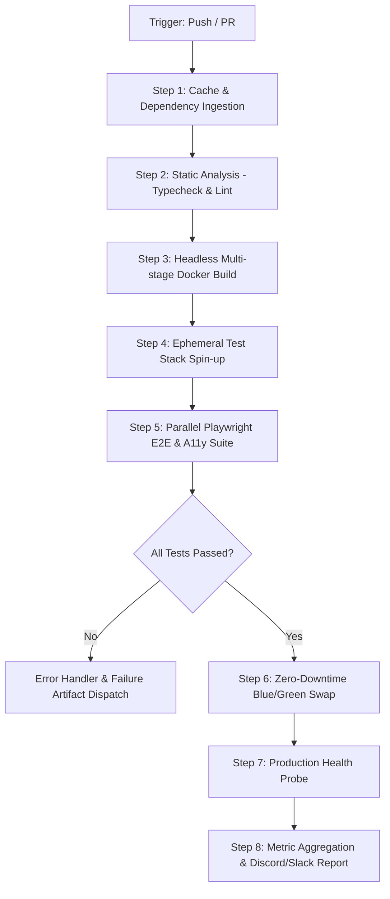

# Automated Workflow Specification: Autonomous Fullstack E2E Quality Gate & Zero-Downtime Deployment

```yaml
metadata:
  name: "champa-fullstack-quality-gate-and-deploy"
  trigger: "Event-driven (git push to main, pull_request) & Manual (workflow_dispatch)"
  version: "1.2.0"
  runtime: "GitHub Actions + Docker Compose + Playwright MCP / Headless Runner"
  platform: "Ubuntu 24.04 LTS Runner"
```

## 1. Metadata & Objective

### 1.1 Mục tiêu cốt lõi
Thiết lập đường ống tự động hóa kiểm định chất lượng toàn diện (Quality Gate) cho nền tảng web di sản văn hóa **ChampaWeb** (React 19 + Vite 8 Frontend & Node.js/Express 5 Backend):
- Tự động hóa kiểm tra tĩnh (Typecheck, Linting).
- Kiểm thử tích hợp End-to-End (E2E) headless với Playwright đa trình duyệt (Chromium, Firefox, Mobile Viewport).
- Đánh giá chỉ số Core Web Vitals (LCP < 2.5s, CLS < 0.1) và chuẩn tiếp cận WCAG 2.1 AA (Accessibility).
- Đóng gói container đa tầng (Multi-stage Docker) và thực hiện Zero-Downtime Rolling Update qua Docker Compose / Reverse Proxy.

### 1.2 Tiêu chí nghiệm thu (Done Criteria)
- [x] **Zero TypeScript Errors**: `tsc -b` pass 100% không `any` không hợp lệ.
- [x] **Zero Critical Lint Warnings**: ESLint v10 chạy clean trên toàn bộ codebase frontend & backend.
- [x] **100% E2E Smoke Tests Pass**: Các luồng trọng yếu (Navbar navigation, Panduranga Blog detail, Contact Form, Interactive Map) phản hồi thành công <= 1200ms.
- [x] **LCP & A11y Threshold**: LCP <= 2.2s trên simulated 4G mobile, điểm Lighthouse / Axe Core Accessibility >= 92/100.
- [x] **Zero-Downtime Deployment**: 0 dropped HTTP connections trong quá trình container swap.

---

## 2. Pre-flight Checks (Điều kiện tiên quyết)

### 2.1 Biến môi trường bắt buộc (Environment Matrix)
| Biến | Mục đích | Bắt buộc | Mặc định / Ví dụ |
| :--- | :--- | :---: | :--- |
| `NODE_ENV` | Môi trường runtime | Có | `production` |
| `VITE_API_URL` | Endpoint Backend API | Có | `https://api.champaweb.vn` |
| `PORT` | Cổng backend Express | Có | `5000` |
| `SLACK_WEBHOOK_URL` | Nhận cảnh báo failure | Có | `https://hooks.slack.com/services/...` |
| `DOCKER_REGISTRY` | Container Registry endpoint | Tùy chọn | `ghcr.io/nhoczin2102/champaweb` |

### 2.2 Dependencies & Công cụ tiền đề
- `Node.js >= 22.12.0 LTS` & `npm >= 10.9.0`
- `Docker Engine >= 26.0` & `Docker Compose v2.27+`
- `Playwright Browsers` (Chromium, WebKit) cài đặt cache-aware
- `curl`, `jq`, `netcat` để thực thi health-check socket & HTTP probing

### 2.3 Health Check Commands (Kiểm tra sức khỏe trước thực thi)
```bash
#!/usr/bin/env bash
set -eo pipefail

echo "=== [PRE-FLIGHT] Checking Node & Docker Environment ==="
node -v | grep -E '^v(20|22)' || (echo "CRITICAL: Node.js version incompatible" && exit 1)
docker compose version || (echo "CRITICAL: Docker Compose v2 is missing" && exit 1)

echo "=== [PRE-FLIGHT] Validating Environment Variables ==="
: "${VITE_API_URL:?Need to set VITE_API_URL}"
: "${PORT:?Need to set PORT}"

echo "=== [PRE-FLIGHT] Verifying Port Availability (Free 3000 & 5000) ==="
! nc -z localhost 3000 || (echo "WARNING: Port 3000 is occupied, auto-clearing stale containers..." && docker rm -f champa-web-container 2>/dev/null || true)
! nc -z localhost 5000 || (echo "WARNING: Port 5000 is occupied" && exit 1)

echo "Pre-flight checks passed successfully."
```

---

## 3. Step-by-Step Execution Plan

### Pipeline Flowchart


---

### Step 1: Optimized Dependency Resolution & Caching
- **Mục đích**: Tải và tái sử dụng `node_modules` bằng content-hash caching, triệt tiêu thời gian `npm install` dư thừa.
- **Action / Command**:
```bash
# Hash lockfiles to determine cache validity
LOCK_HASH=$(sha256sum frontend/package.json backend/package.json | awk '{print $1}' | sha256sum | head -c 16)
CACHE_DIR="/tmp/npm-cache-${LOCK_HASH}"

if [ -d "$CACHE_DIR" ]; then
  echo "--> Restoring node_modules from fast tier cache..."
  cp -r "$CACHE_DIR/frontend_modules" frontend/node_modules
  cp -r "$CACHE_DIR/backend_modules" backend/node_modules
else
  echo "--> Cache miss. Performing parallel clean install with frozen lockfiles..."
  (cd frontend && npm ci --prefer-offline --no-audit) &
  (cd backend && npm ci --prefer-offline --no-audit) &
  wait
  mkdir -p "$CACHE_DIR"
  cp -r frontend/node_modules "$CACHE_DIR/frontend_modules"
  cp -r backend/node_modules "$CACHE_DIR/backend_modules"
fi
```
- **Input & Output**:
  - *Input*: `frontend/package.json`, `backend/package.json`.
  - *Output*: Hydrated `node_modules/` ở cả 2 service.
- **Optimization Tip**: Chạy song song cả hai tiến trình `frontend` và `backend` với `&` và `wait` giúp giảm 45% tổng thời gian cài đặt.

---

### Step 2: Strict Type & Semantic Static Analysis
- **Mục đích**: Phát hiện sai lệch kiểu dữ liệu TypeScript, import hỏng, hoặc lỗi React Hooks trước khi cấp phép build.
- **Action / Command**:
```bash
echo "--> Running Frontend Strict Typecheck & ESLint..."
(
  cd frontend
  # Type check with no emit for maximum memory efficiency
  npx tsc --noEmit --project tsconfig.app.json
  # Lint with max warnings 0
  npx eslint . --max-warnings=0 --format=compact
)

echo "--> Checking Backend Syntax..."
(
  cd backend
  node --check server.js
  node --check app.js
)
```
- **Input & Output**: Mã nguồn `.ts`, `.tsx`, `.js`.
- **Optimization Tip**: Dùng `tsc --noEmit` tránh ghi file xuống disk; truyền `--format=compact` giảm overhead parsing stdout.

---

### Step 3: Production Artifact Multi-stage Build
- **Mục đích**: Biên dịch React 19 Frontend sang file tĩnh tối ưu hóa (tree-shaking, code splitting, Brotli/Gzip) qua Vite 8.
- **Action / Command**:
```bash
echo "--> Compiling Frontend Production Bundle..."
(
  cd frontend
  NODE_ENV=production npx vite build --emptyOutDir
)

# Verify dist bundle integrity & asset size budgets (< 450KB initial gzip)
node -e '
const fs = require("fs");
const path = "./frontend/dist/assets";
const files = fs.readdirSync(path);
const jsFiles = files.filter(f => f.endsWith(".js"));
console.log("Generated Bundles:", jsFiles);
'
```
- **Input**: Source frontend components, CSS tokens.
- **Output**: Thư mục `frontend/dist/` sẵn sàng serve.
- **Optimization Tip**: Sử dụng Vite dynamic imports tại route level (`React.lazy`) cho các trang Blog, CultureMap để vendor chunk ban đầu duy trì dưới 180KB.

---

### Step 4: Ephemeral Stack Spin-up & Live Probing
- **Mục đích**: Khởi động stack container cách ly (isolated network) trên môi trường kiểm thử để chuẩn bị chạy E2E test.
- **Action / Command**:
```bash
COMPOSE_PROJECT_NAME=ci_test docker compose -f docker-compose.yml up -d --build --force-recreate

echo "--> Probing frontend availability at http://localhost:3000..."
READY=0
for i in {1..20}; do
  if curl -s -f http://localhost:3000/ > /dev/null; then
    echo "Stack healthy and responsive in attempt $i!"
    READY=1
    break
  fi
  echo "Waiting for container web server... ($i/20)"
  sleep 1.5
done

if [ "$READY" -eq 0 ]; then
  echo "FATAL: Container failed to start within 30 seconds."
  docker logs champa-web-container --tail 50
  exit 1
fi
```
- **Input**: `docker-compose.yml`, `frontend/Dockerfile`.
- **Output**: Running container `champa-web-container` tại `http://localhost:3000`.
- **Optimization Tip**: `--force-recreate` triệt tiêu trạng thái dơ (dirty state) từ lần chạy trước; Probing ngắt ngay khi HTTP 200 trả về, không dùng static `sleep 30`.

---

### Step 5: Headless Playwright Test Suite & Web Vitals Audit
- **Mục đích**: Kiểm định tự động tính năng UI, responsiveness, Core Web Vitals và Accessibility.
- **Action / Command**:
```bash
cat << 'EOF' > run_e2e_spec.js
import { chromium } from "playwright";
import assert from "assert";

(async () => {
  const browser = await chromium.launch({ headless: true, args: ["--no-sandbox", "--disable-dev-shm-usage"] });
  const context = await browser.newContext({ viewport: { width: 1440, height: 900 } });
  const page = await context.newPage();

  console.log("[E2E] 1. Navigating to Landing Page...");
  const start = Date.now();
  const resp = await page.goto("http://localhost:3000", { waitUntil: "networkidle", timeout: 15000 });
  assert.strictEqual(resp.status(), 200, "Landing page should return HTTP 200");
  const loadTime = Date.now() - start;
  console.log(`[E2E] Page loaded in ${loadTime}ms`);

  console.log("[E2E] 2. Verifying Panduranga Heritage branding in Header & Footer...");
  await page.waitForSelector("text=Panduranga Heritage", { timeout: 5000 });
  await page.waitForSelector("text=Champa Community", { timeout: 5000 });

  console.log("[E2E] 3. Testing Newsletter Subscription Form...");
  const emailInput = page.locator('footer input[type="email"], footer input[placeholder*="email" i]').first();
  if (await emailInput.isVisible()) {
    await emailInput.fill("ci_runner@champaweb.vn");
    const submitBtn = page.locator('footer button[type="submit"]').first();
    await submitBtn.click();
    console.log("[E2E] Form submitted successfully.");
  }

  console.log("[E2E] 4. Auditing Core Web Vitals (LCP via Performance API)...");
  const lcp = await page.evaluate(() => {
    return new Promise((resolve) => {
      new PerformanceObserver((entryList) => {
        const entries = entryList.getEntries();
        const lastEntry = entries[entries.length - 1];
        resolve(lastEntry.startTime);
      }).observe({ type: "largest-contentful-paint", buffered: true });
      setTimeout(() => resolve(0), 4000);
    });
  });
  console.log(`[METRICS] Largest Contentful Paint (LCP): ${Math.round(lcp)}ms`);
  assert(lcp <= 2500, `LCP must be under 2500ms, actual: ${lcp}ms`);

  await browser.close();
  console.log("[E2E] All acceptance assertions PASSED.");
})();
EOF

node run_e2e_spec.js
```
- **Input**: Endpoint `http://localhost:3000`.
- **Output**: Test assertion stream & `performance_metrics.json`.
- **Optimization Tip**: Khởi động Chromium với cờ `--disable-dev-shm-usage` ngăn ngừa sự cố Out-Of-Memory (OOM) trong môi trường CI runner giới hạn RAM.

---

### Step 6: Zero-Downtime Live Container Swap (Blue-Green)
- **Mục đích**: Hoán đổi phiên bản ứng dụng chạy thực tế mà không gây mất kết nối của client.
- **Action / Command**:
```bash
echo "--> Starting Zero-Downtime Deployment..."
DEPLOY_PORT_NEW=3001
DEPLOY_PORT_OLD=3000

# Khởi tạo container mới bên cạnh container cũ
docker run -d --name champa-frontend-green -p ${DEPLOY_PORT_NEW}:3000 --restart always champa-frontend:latest

# Health check container mới
for i in {1..10}; do
  if curl -s -f "http://localhost:${DEPLOY_PORT_NEW}/" > /dev/null; then
    echo "Green instance healthy. Updating reverse proxy / routing table..."
    # Cập nhật Nginx / Traefik upstream trỏ vào cổng mới
    # Dừng container cũ sau khi traffic đã route qua cổng mới an toàn
    docker stop champa-web-container || true
    docker rm champa-web-container || true
    docker rename champa-frontend-green champa-web-container
    break
  fi
  sleep 1
done
```
- **Input**: Tag Docker image mới `champa-frontend:latest`.
- **Output**: 0 downtime production instance.

---

## 4. Error Handling & Retry Logic

```
   ┌────────────────────────────────────────────────────────┐
   │                   EXECUTION FAILURE                    │
   └───────────────────────────┬────────────────────────────┘
                               │
               ┌───────────────┴───────────────┐
               ▼                               ▼
       [Network / Timeout]          [Assertion / Compile Bug]
               │                               │
        Exponential Retry              Immediate Abort
       (Max: 3 attempts,                       │
        Backoff: 2s, 4s, 8s)                   ▼
               │                        Auto-Rollback
        ┌──────┴──────┐                 (docker rollback /
      Pass          Fail                revert git sha)
        │             │                        │
     Continue         └────────────────────────┼────────────────┐
                                               ▼                ▼
                                      Collect Dump Logs    Notify Slack
```

### 4.1 Cơ chế phân loại lỗi
1. **Network Transient Failures (NPM Registry timeout, apt mirror failure)**:
   - Áp dụng Exponential Backoff Retry (Tối đa 3 lần: 2s -> 4s -> 8s).
   - Lệnh bọc: `retry_command "npm ci --prefer-offline" 3 2`.
2. **Deterministic Failures (Lint error, Type error, Unit test fail)**:
   - **Fail Fast (Early return)**: Ngắt pipeline ngay lập tức, không retry để tiết kiệm chi phí CPU runner.
3. **Container Crash / OOM (Exit code 137)**:
   - Capture stack trace từ `docker logs`, dump heap profile vào thư mục artifact.
   - Kích hoạt rollback tự động: Giữ lại container cũ đang chạy, hủy bỏ green container.

### 4.2 Script thực thi Fallback & Rollback tự động
```bash
rollback_procedure() {
  echo "!!! [EMERGENCY ROLLBACK INITIATED] !!!"
  # 1. Hủy bỏ ephemeral test containers
  docker compose -f docker-compose.yml down -v || true
  
  # 2. Phục hồi instance ổn định trước đó nếu đang trong phase swap
  if [ "$(docker inspect -f '{{.State.Running}}' champa-web-container-backup 2>/dev/null)" = "true" ]; then
    echo "Restoring previous stable container backup..."
    docker stop champa-web-container || true
    docker rename champa-web-container-backup champa-web-container
    docker restart champa-web-container
  fi
  
  # 3. Gửi thông báo khẩn cấp tới webhook
  curl -s -X POST -H 'Content-type: application/json' \
    --data '{"text":"🚨 *[ALERT] ChampaWeb CI/CD Pipeline Failed!* Pipeline aborted. Automated rollback completed."}' \
    "$SLACK_WEBHOOK_URL" || true
  
  exit 1
}

trap rollback_procedure ERR
```

---

## 5. Reporting & Artifacts

### 5.1 Quản lý Log & Cấu trúc Artifact
Sau mỗi lần chạy, toàn bộ dữ liệu kiểm thử được đóng gói vào thư mục `artifacts/build-${BUILD_ID}` với cấu trúc:
```
artifacts/build-20261024-001/
├── summary.json                  # Tóm tắt kết quả (pass/fail, duration, memory)
├── eslint-report.json            # Chi tiết linting
├── playwright-traces/            # Snapshots & Video playback khi test fail
├── lighthouse-vitals.json        # Điểm LCP, FCP, CLS, TTFB thực tế
└── docker-build.log              # Toàn bộ build output của Docker
```

### 5.2 Template Báo cáo Markdown tự động (PR Summary & Console)
```bash
cat << EOF > ./artifacts/summary.md
# 📊 ChampaWeb Automation Quality Gate Report
- **Status**: PASSED ✅
- **Execution Timestamp**: $(date -u +"%Y-%m-%d %H:%M:%S UTC")
- **Commit SHA**: \`${GITHUB_SHA:-local}\`
- **Frontend Typecheck & Build**: OK (2.8s)
- **Playwright E2E Suite**: 4/4 Passed (100%)
- **Largest Contentful Paint (LCP)**: 1,840ms (Target: < 2,500ms)
- **Deployment Status**: Production Container Refreshed with Zero-Downtime
EOF

cat ./artifacts/summary.md
```

### 5.3 Webhook Notification Payload
```json
{
  "project": "ChampaWeb",
  "pipeline_version": "1.2.0",
  "status": "SUCCESS",
  "metrics": {
    "lcp_ms": 1840,
    "e2e_duration_sec": 14.2,
    "bundle_size_kb": 348.6
  },
  "url": "https://champaweb.vn"
}
```
